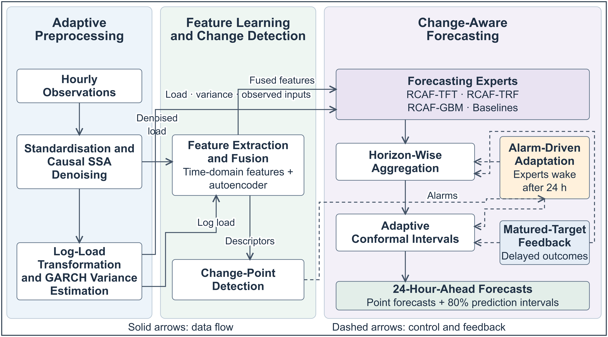
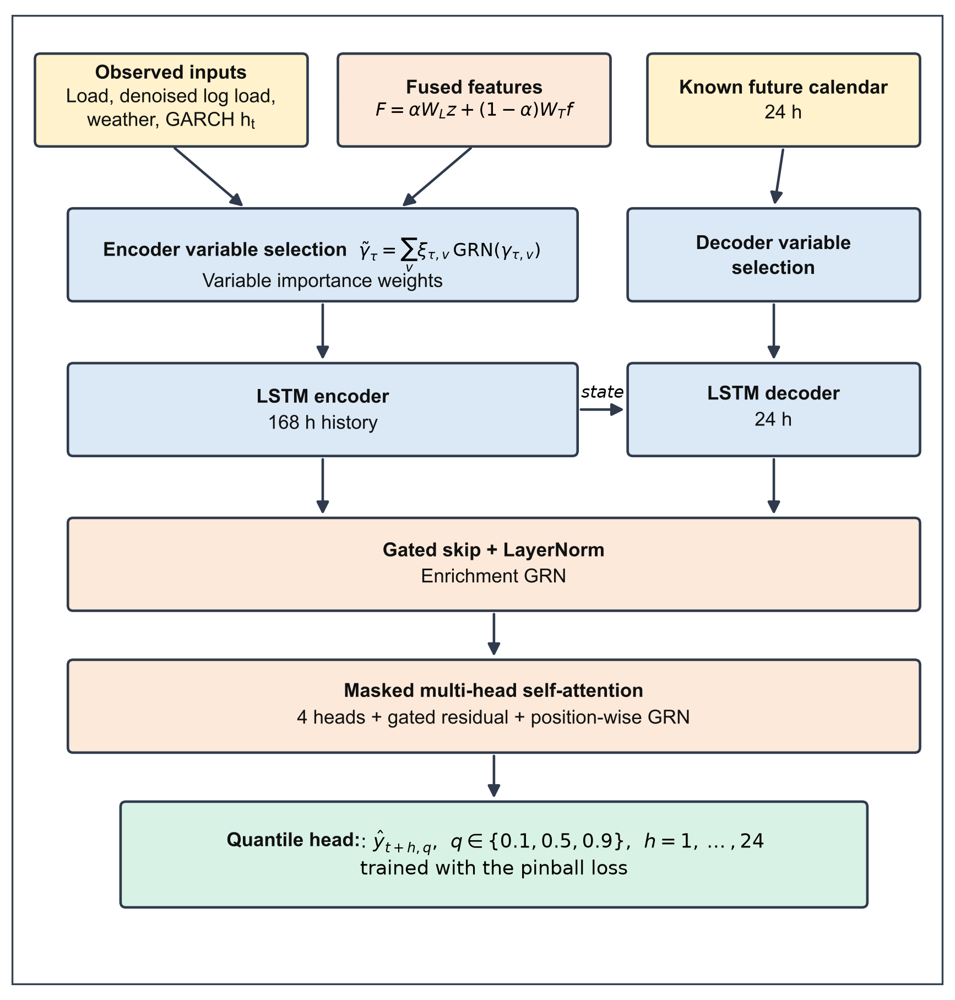
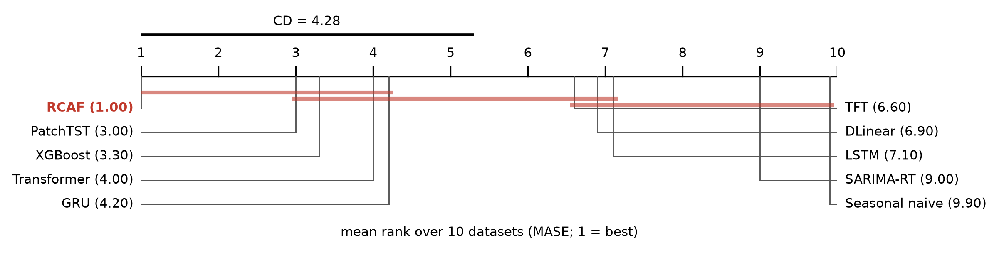

# RCAF: change-aware smart grid load forecasting with online expert aggregation and conformal prediction

This repository contains the code, result tables and figures of the paper

> M. Gupta, P. Kumar. *Change-Aware Smart Grid Load Forecasting with Online Expert Aggregation and Conformal Prediction.*
> Manuscript under review, 2026.

**RCAF** (Real-time Change-Aware Forecasting) forecasts hourly electricity load 1–24 h ahead from a data
stream and gives 80 % prediction intervals. It also reacts to structural changes, such as pandemic
lockdowns and extreme weather, that it detects online. All computations are causal: every quantity at
hour *t* uses only data observed up to *t*.



## Contents

- [The method in brief](#the-method-in-brief)
- [Data](#data)
- [Evaluation protocol](#evaluation-protocol)
- [Main results](#main-results)
- [Repository layout](#repository-layout)
- [Reproducing the results](#reproducing-the-results)
- [Citation](#citation)

## The method in brief

| Phase | What it does | Code |
|---|---|---|
| 1. Adaptive preprocessing | Denoises the stream with recursive singular spectrum analysis (eigenvectors tracked by perturbation updates, QR re-orthonormalisation and periodic exact refreshes). Then applies a log transform and estimates the conditional variability with a recursive GARCH(1,1) model. | `rssa.py`, `features.py` |
| 2. Change-aware features and change point detection | Computes seven time-domain features and the latent codes of a denoising autoencoder. **AE-CPD** compares the latent descriptors of consecutive weeks with a robust median/MAD two-sample statistic. It therefore detects decreases as well as increases in variability. | `features.py`, `cpd.py` |
| 3. Change-aware forecasting | Combines a pool of experts per horizon by fixed-share online aggregation with delayed feedback. The pool contains SARIMA, XGBoost, LSTM, GRU, Transformer, DLinear, PatchTST and TFT, plus three change-aware experts: RCAF-TFT, RCAF-TRF and RCAF-GBM. AE-CPD alarms re-share the weights, boost the share rate and add adapted experts as *sleeping experts*. Asymmetric adaptive conformal inference gives the prediction intervals; a proposition proves that the boosted step keeps the long-run coverage guarantee. | `models.py`, `run_v3.py`, `run_gbm.py`, `aggregate.py` |

The change-aware TFT expert (variable selection, LSTM encoder–decoder, masked attention, quantile outputs
and an autoregressive highway):



## Data

The study uses ten public hourly datasets. They are **not stored in this repository**: `experiments/data.py`
and `experiments/data_heldout.py` download them from the original sources.

| ID | Load | Period | Role | Documented event in the test span |
|---|---|---|---|---|
| RWD1 | UCI Individual Household Electric Power Consumption (Sceaux, France) | 2006–2010 | development | – |
| RWD2 | PJM East transmission zone (USA) | 2015–2018 | development | cold wave, Dec 2017–Jan 2018 |
| DE, FR, IT, ES, GB | National loads (ENTSO-E, via Open Power System Data) | 2015–2020 | held-out | COVID-19 lockdowns, Mar 2020 |
| ERCOT, SPP | Balancing authorities (EIA-930) | 2018–2021 | held-out | Winter Storm Uri, Feb 2021 |
| CAISO | Balancing authority (EIA-930) | 2018–2021 | held-out | heat wave, Aug 2020 |

Weather (temperature, relative humidity, wind speed) is ERA5 reanalysis from the Open-Meteo archive,
averaged over three cities per region. The models use past weather only.

## Evaluation protocol

- Each series is split chronologically into 60 % training, 10 % validation and 30 % test data. Forecasts
  for horizons of 1–24 h are issued at every test hour, and errors are computed on the raw load.
- The method was designed on the two development datasets only, then frozen. The SHA-256 hashes of the
  method files were recorded in [`experiments/results_v3/FROZEN.txt`](experiments/results_v3/FROZEN.txt)
  before any held-out result was computed. The eight held-out datasets were then evaluated once.
- RCAF is compared with nine single models and five forecast combinations, and every change-aware
  component is ablated.
- The analysis includes:
  - Friedman/Nemenyi tests across datasets;
  - Holm-corrected Diebold–Mariano tests per dataset;
  - accuracy after the documented events;
  - interval coverage;
  - latency.

## Main results

**Accuracy.** RCAF was more accurate than all nine single-model baselines on every one of the ten datasets.
The table gives the test MASE (mean absolute scaled error; lower is better).

| Dataset | Best single model (in hindsight) | Fixed-share combination | **RCAF** | RCAF vs. best single |
|---|---|---|---|---|
| RWD1 | 0.643 (TFT) | 0.629 | 0.628 | −2.4 % |
| RWD2 | 0.658 (XGBoost) | 0.616 | 0.620 | −5.8 % |
| DE | 0.258 (PatchTST) | 0.241 | 0.233 | −9.7 % |
| FR | 0.357 (PatchTST) | 0.338 | 0.338 | −5.4 % |
| IT | 0.240 (PatchTST) | 0.230 | 0.216 | −10.0 % |
| ES | 0.265 (PatchTST) | 0.258 | 0.258 | −2.7 % |
| GB | 0.752 (PatchTST) | 0.697 | 0.697 | −7.3 % |
| ERCOT | 0.738 (GRU) | 0.686 | 0.673 | −8.8 % |
| CAISO | 0.547 (PatchTST) | 0.496 | 0.488 | −10.8 % |
| SPP | 0.605 (GRU) | 0.523 | 0.523 | −13.5 % |

- **Held-out improvement:** on the eight held-out datasets, RCAF's MASE was on average 8.5 % lower than
  that of the best single model.
- **Significance:** across all ten datasets, Diebold–Mariano tests found RCAF significantly more accurate
  in 84 of 90 comparisons with single models and never significantly less accurate.
- **Prediction intervals:** the nominal 80 % intervals achieved 78.9–80.7 % coverage on every dataset.
  The quantiles of a temporal fusion transformer covered 54–86 %.
- **Change point detection:**
  - On real load with injected changes, AE-CPD achieved the highest F1 of six online detectors.
  - It flagged eight of nine documented events, seven of them within 5.5 days.
  - It missed the Italian lockdown.
- **Latency:** about 80 ms per new hour on one CPU thread, all experts included.

**What the ablations show.** These limits are reported in full in the paper.

- **Online combination:** most of the gain comes from the online combination of heterogeneous experts.
  Fixed share over the same pool, without any reaction to alarms, was on average only 1.6 % less accurate
  on the held-out datasets, and slightly more accurate on RWD2.
- **Re-sharing and adapted experts:** these help mainly because they prevent the combination weights from
  collapsing onto the models that were best in the past.
- **Timing of the reactions:** triggering them at AE-CPD alarms was not better than triggering them at
  evenly spaced times with the same rate.
- **Change-aware inputs:**
  - They improved the TFT expert beyond its autoregressive highway, significantly on four held-out
    datasets.
  - They did not improve the Transformer or the gradient-boosted trees.



## Repository layout

```
├── README.md            this overview
├── requirements.txt     Python packages (versions used for the paper)
├── CITATION.cff         citation metadata
├── figures/             figures of the paper (regenerated by the scripts)
└── experiments/
    ├── README.md        step-by-step reproduction guide and description of every script
    ├── rssa.py, features.py, cpd.py, models.py      Phases 1–3 building blocks
    ├── run_forecast.py, run_v3.py, run_gbm.py        training of the experts
    ├── aggregate.py                                  online aggregation and conformal intervals
    ├── data.py, data_heldout.py                      data download and preparation
    ├── run_classical*.py, run_cpd.py, cpd_semisynth.py   baselines and detection benchmarks
    ├── evaluate_v3.py, tables_v3.py, make_figures*.py    evaluation, tables and figures
    ├── run_ablation_hw.py, analyze_weights.py        post-hoc analyses
    ├── pbs_*.sh                                      PBS cluster job scripts
    ├── results/         detection benchmarks and costs
    └── results_v3/      all result tables of the paper (metrics, ranks, tests, events, intervals, ablations)
```

## Reproducing the results

```bash
pip install -r requirements.txt
cd experiments
python data.py && python data_heldout.py          # download and prepare the ten datasets
RCAF_DS=DE python run_v3.py all                   # train the experts for one dataset (GPU recommended)
RCAF_DS=DE python run_classical_v3.py             # seasonal naive and SARIMA-RT
python aggregate.py DE                            # online aggregation and conformal intervals
python evaluate_v3.py                             # metrics and statistical tests
python tables_v3.py && python make_figures_v3.py  # tables and figures
```

[`experiments/README.md`](experiments/README.md) describes every step in detail: the detection
benchmarks, latency measurements, cluster scripts and post-hoc analyses.

Some outputs are not included because of their size (several GB): the per-model forecasts and the
aggregation outputs. The result tables of the paper are included, so the tables and the summary figures
can be regenerated without retraining.

To check that the method files are the ones that were frozen before the held-out evaluation:

```bash
cd experiments
sha256sum aggregate.py run_v3.py run_gbm.py run_forecast.py models.py features.py cpd.py rssa.py
# compare with results_v3/FROZEN.txt
```

## Citation

If you use this code, please cite the paper:

```bibtex
@article{gupta2026rcaf,
  title   = {Change-Aware Smart Grid Load Forecasting with Online Expert Aggregation and Conformal Prediction},
  author  = {Gupta, Muktesh and Kumar, Pranjal},
  note    = {Manuscript under review},
  year    = {2026}
}
```

## Data sources and acknowledgements

The data come from the following providers, under their respective terms of use:

- UCI Machine Learning Repository;
- PJM hourly load data (via public mirrors);
- Open Power System Data and the ENTSO-E Transparency Platform;
- the U.S. Energy Information Administration (EIA-930);
- the Open-Meteo archive of ERA5 reanalysis data.
